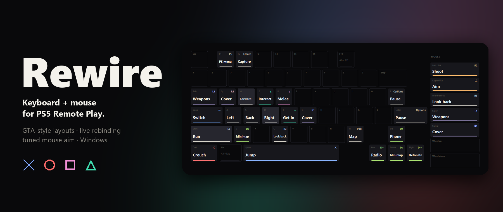
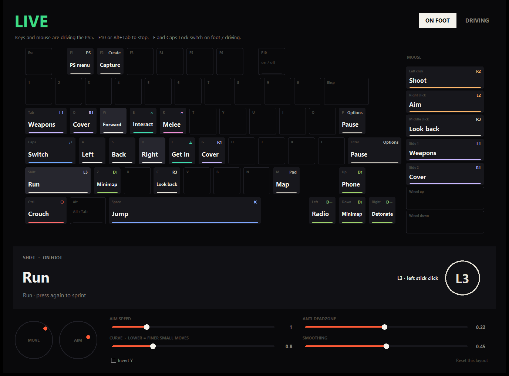
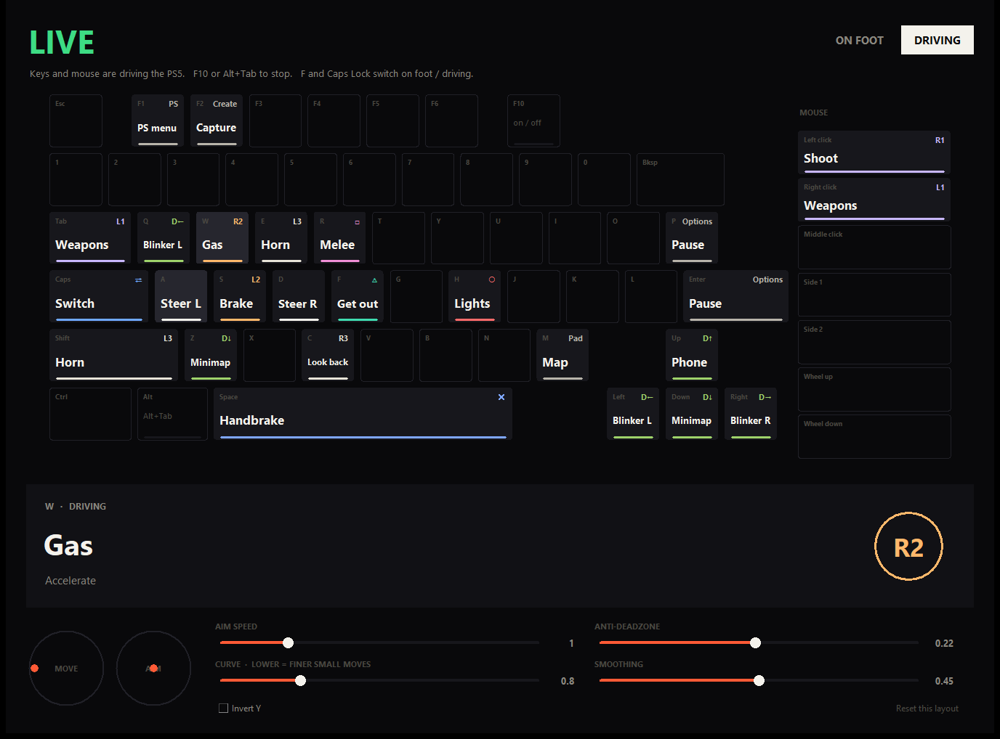
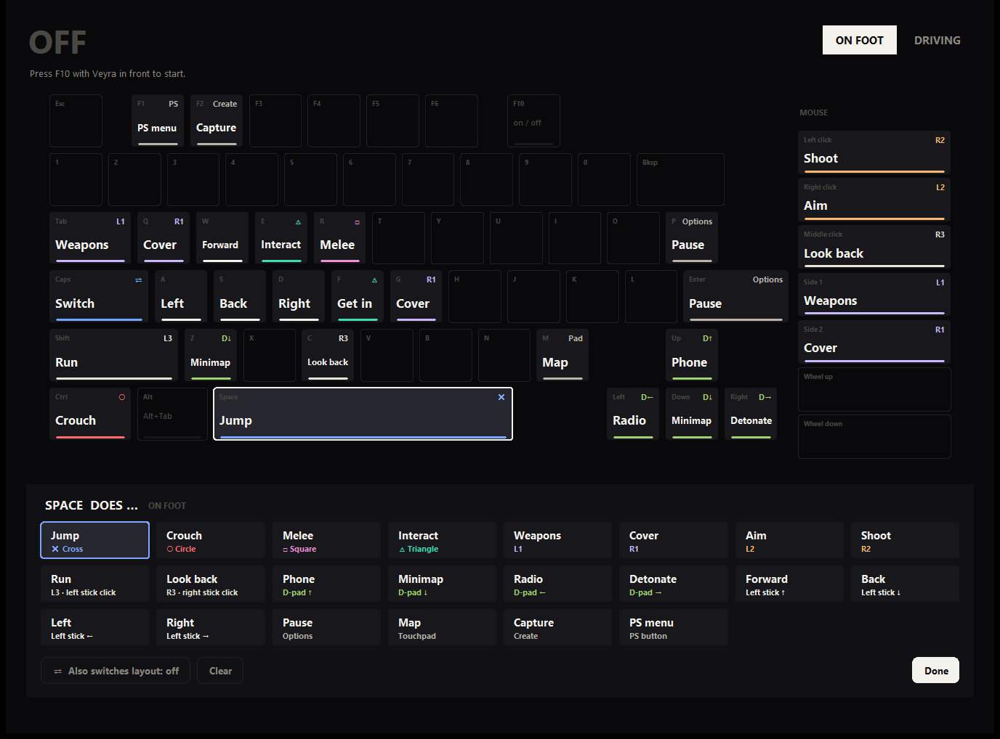
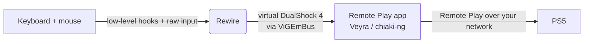

<p align="center">
  
</p>

<p align="center">
  <b>Play your PS5 with a keyboard and mouse, from your PC, over Remote Play.</b><br>
  No capture card, no adapter, no extra hardware.
</p>

<p align="center">⭐ if you like this, please star it, it really helps people find it ⭐</p>

<p align="center">
  
  
  
</p>

---

Rewire turns your keyboard and mouse into a virtual PlayStation controller. Your Remote Play app picks
it up like a normal pad and sends it to the console. You stay on your desktop the whole time.

It ships with layouts modelled on GTA V's PC controls, mapped onto GTA 6's PS5 buttons: one layout
on foot, one for driving. It switches between them when you get in and out of a car.

## What it looks like

<p align="center"></p>

**Every key says what it does.** "Jump", "Run", "Get in", not "Cross" or "L3". The colour bar and corner
symbol show the PS button underneath, in PlayStation's own colours: blue ✕, red ○, pink □, green △. Keys
light up as you press them, and the panel shows what the last one did.

<p align="center"></p>

**Get in a car and the whole keyboard changes.** W becomes gas, S brake, Space handbrake, H headlights.
Get out and it switches back.

<p align="center"></p>

**Rebinding takes one click.** Click a key, pick an action from the grid, done. Any key can also flip
between the on-foot and driving layouts, the way F does when you enter a car.

## Highlights

- **Controller and keyboard at the same time.** Plug your DualSense (or any pad) in and Rewire merges it
  into the same virtual controller, rumble included. Grab the pad for a cutscene, the mouse for a shootout,
  no switching or unplugging. [HidHide](https://github.com/nefarius/HidHide) hides the real pad from other
  apps while Rewire runs, so the Remote Play app only sees one controller, and gives it back when you close Rewire.
- **Mouse aim that feels like a mouse.** Raw mouse input turns into stick tilt, and you can tune it live
  with an anti-deadzone, a response curve, smoothing and speed. It stops dead when your hand stops, so the
  camera doesn't drift.
- **Two layouts, switched automatically.** Pressing F to enter or exit a car swaps WASD from walking to
  gas, brake and steering. Caps Lock swaps by hand.
- **It never fights your PC.** Rewire only takes over while it's armed **and** your Remote Play window is
  in front. Alt+Tab away and every key goes back to normal and your cursor is freed. Alt+Tab and Alt+F4
  always work.
- **Nothing gets stuck.** A key is only held on the controller if Rewire saw you press it, so stray
  releases can't get stuck, and any error drops it to OFF and frees your cursor.
- **Resizable.** The whole keyboard scales with the window.

## How it works



Rewire never touches the console or the game. To the PS5 it is just a controller connected through
Remote Play.

## Setup

1. **Install [ViGEmBus](https://github.com/nefarius/ViGEmBus/releases)**, the virtual controller driver.
   It needs one admin prompt.
2. **Optional, to use your controller alongside keyboard + mouse:** install
   [HidHide](https://github.com/nefarius/HidHide/releases), then unplug and replug your controller once.
3. **Install Python 3.10+**, then:
   ```
   pip install -r requirements.txt
   ```
4. **Pair your PS5** with a Remote Play app. Rewire is built and tested against
   [Veyra](https://github.com/Likely7/Veyra-NRVideo). For another app, add its `.exe` name to
   `targets` in `config.json`.
5. Run `Rewire.bat`. It opens on your second monitor if you have one, and remembers where you put it. (or `pythonw rewire.pyw`).

## Playing

| | |
|---|---|
| **F10** | Arm / disarm. Rewire goes **LIVE** once your Remote Play window is in front |
| **Alt+Tab** | Leave. Everything is released and your cursor comes back |
| **F / Caps Lock** | Switch between the on-foot and driving layouts |
| **Ctrl+Alt+Del, then Esc** | Emergency: frees the cursor whatever happens |

> Without HidHide, unplug your real controller while you play: most Remote Play apps only listen to one pad.
> If Rewire ever crashes while hiding your controller, run `unhide.bat`.
>
> If your Remote Play app has its own shortcuts on Space, F or Tab (Veyra does), move them to
> Ctrl+key in its settings. Otherwise they fire while Rewire is off.

## Default GTA layout

| Key | On foot | Driving |
|---|---|---|
| WASD | Move | W gas · S brake · A/D steer |
| Mouse | Look and aim · L-click shoot · R-click aim | Look · L-click drive-by |
| Space | Jump / climb | Handbrake |
| Shift | Run, press again to sprint | Nitrous |
| Ctrl | Crouch | |
| F | Get in (switches to driving) | Get out (switches to on foot) |
| E | Interact | Horn |
| Q · Tab · C · R | Cover · weapons · look back · melee | Radio · weapons · look back · melee |
| H | | Headlights |
| M · P | Map · pause | Map · pause |
| Arrows | Phone · radio · objectives · detonate | Phone · blinkers · objectives |

All of it can be rebound in the app. Bindings and aim settings save to `config.json`.

## Notes

- Built for **single-player**. Using a mouse against controller players online is unfair, and those games'
  rules may treat it like an adapter. Keep it to story mode.
- GTA 6's controls come from its in-game control screens as reported on launch day. If a default is off,
  click the key and fix it.
- Not affiliated with Sony, Rockstar or the Remote Play apps it works with.

## License

MIT
